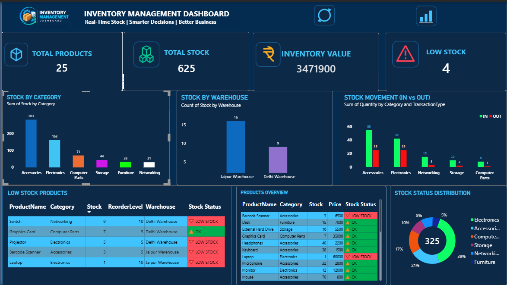

# Real-Time Inventory Management System

## Project Overview

A Real-Time Inventory Management System developed using Python, Tkinter, MySQL, Microsoft Excel, and Power BI.

This project helps manage inventory products, track stock movements, monitor stock levels, and analyze inventory performance through an interactive Power BI dashboard.

## Dashboard Preview

## Dashboard Preview




## Key Features

- Add and manage inventory products.
- Update product stock and prices.
- Record stock IN, OUT, and ADJUSTMENT transactions.
- MySQL database integration.
- Automatic Excel report updates using Python.
- Interactive Power BI dashboard.
- Identify Low Stock and Out of Stock products.
- Monitor inventory value and stock movements.

## Technologies Used

- Python
- Tkinter
- MySQL
- Microsoft Excel
- Power BI
- Pandas
- OpenPyXL
- Python Dotenv

## Project Structure

```text
Inventory_Management_System/
│
├── powerbi/
│   └── INVENTORY MANAGEMENT DASHBOARD.pbix
│
├── screenshots/
│   └── dashboard.png
│
├── Inventory_Dashboard_Icons_PNG (1)/
│   ├── 01_Total_Products.png
│   ├── 02_Total_Stock.png
│   ├── 03_Inventory_Value.png
│   ├── 04_Low_Stock_Products.png
│   ├── 05_Refresh.png
│   ├── 06_Better_Data_Analytics.png
│   ├── Inventory Management Dashboard Branding.png
│   └── Inventory_Report.xlsx
│
├── app.py
├── database.py
├── background_service.py
├── powerbi_refresh.py
├── 01_setup_database.sql
├── requirements.txt
├── .gitignore
└── README.md
```

## Database

**Database Name:** `I_M_S_Real`

**Main Tables:**
- `products`
- `inventory_transactions`

## How to Run the Project

1. Install Python and MySQL Server.
2. Clone or download this repository.
3. Create a `.env` file in the project root directory with your MySQL connection details:

```env
IMS_DB_HOST=localhost
IMS_DB_PORT=3306
IMS_DB_USER=root
IMS_DB_PASSWORD=your_mysql_password
IMS_DB_NAME=I_M_S_Real
```

4. Create the database using `01_setup_database.sql`.
5. Install the required Python libraries:

```bash
pip install -r requirements.txt
```

6. Start the application:

```bash
python app.py
```

7. Start the automatic Excel update service:

```bash
python background_service.py
```

## Power BI Dashboard

Open the Power BI file from the `powerbi` folder to explore the interactive Inventory Management Dashboard.

## Contact Me

Feel free to reach out if you have any questions, suggestions, or just want to connect!

- **Email:** [sunilsharma.work@outlook.com](mailto:sunilsharma.work@outlook.com)
- **Phone:** +91 9352628954
- **LinkedIn:** [linkedin.com/in/sunil sharma](https://www.linkedin.com/in/sunil-sharma-31003143a/)

## Author

**Sunil Sharma**

MIS Executive | Data Analyst

Jaipur, Rajasthan, India

I look forward to hearing from you!
